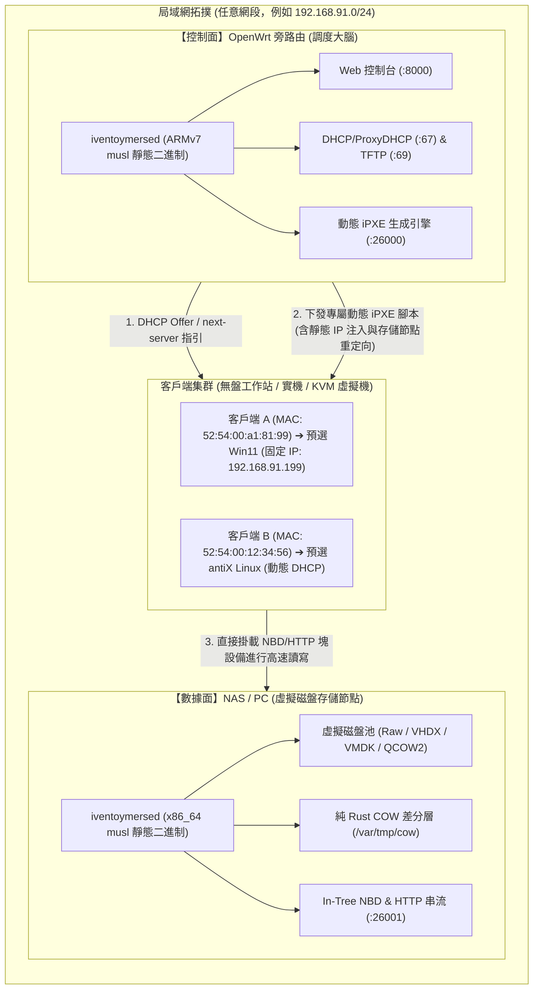

# iventoymersed 旁路由解耦集群與純 Web 操控保姆式圖文教程 🇹🇼

> **集群架構**：控制面（OpenWrt 旁路由調度大腦）與數據面（NAS/工作站 虛擬磁盤存儲節點）物理級解耦  
> **核心優勢**：全動態自適應網絡架構（Zero-Hardcoded IP）· 純 Web 介面 0 命令行操作 · 客戶端 MAC 預選與靜態 IP 雙通道注入 · 支援 Windows 11 / Linux 原生無盤秒啟

---

## 📖 目錄 (Table of Contents)

1. [架構全景與解耦原理 (Architecture Overview)](#1-架構全景與解耦原理-architecture-overview)
2. [實體環境與硬體準備 (Prerequisites)](#2-實體環境與硬體準備-prerequisites)
3. [第一步：存儲節點 (Virtual NAS) 部署 (Step 1: Storage Node)](#3-第一步存儲節點-virtual-nas-部署-step-1-storage-node)
4. [第二步：旁路由調度大腦部署 (Step 2: Orchestrator on OpenWrt)](#4-第二步旁路由調度大腦部署-step-2-orchestrator-on-openwrt)
5. [第三步：純 Web 控制台配置（0 命令行） (Step 3: Web UI Setup)](#5-第三步純-web-控制台配置0-命令行-step-3-web-ui-setup)
6. [第四步：客戶端網絡開機與雙通道調度實測 (Step 4: Client Boot)](#6-第四步客戶端網絡開機與雙通道調度實測-step-4-client-boot)
7. [第五步：操作系統黃金桌面實體驗收 (Step 5: Golden Verification)](#7-第五步操作系統黃金桌面實體驗收-step-5-golden-verification)
8. [常見踩坑與排錯 FAQ (Troubleshooting & FAQs)](#8-常見踩坑與排錯-faq-troubleshooting--faqs)

---

## 1. 架構全景與解耦原理 (Architecture Overview)

傳統的無盤 PXE 伺服器往往將「DHCP/TFTP 服務」、「Web 儀表板」與「數百 GB 的母盤鏡像檔案」塞在同一台電腦上。這會帶來三大痛點：
1. **路由器硬體性能有限**：幾十元台幣的低成本路由器（RAM 僅 128MB~256MB）根本裝不下大容量硬碟，無法承載大量 Windows/Linux 鏡像；
2. **NAS 與路由器網段耦合**：代碼中若是把伺服器 IP 硬寫死（如 `192.168.1.1` 或 `192.168.91.11`），一旦使用者搬遷網段或更改主機 IP，引導腳本立刻全面崩潰；
3. **客戶端 IP 無法精準預先指派**：大量客戶端同時開機時，DHCP 隨機分發 IP，造成無法預先綁定業務靜態 IP。

### 🚀 iventoymersed v3.5.1 解耦集群拓撲



- **調度大腦（Orchestrator）**：常駐於 OpenWrt 旁路由（例如極路由、MT7981 路由器等，記憶體開銷 < 2MB），負責 Web 儀表板管理、MAC 綁定預設、以及向客戶端提供動態 iPXE 腳本；
- **存儲節點（Storage Node）**：常駐於 NAS、Unraid、TrueNAS 或實體 Linux 主機，掛載 2TB+ 高速 NVMe/SATA 硬碟，承載真正的作業系統母盤與 COW 差分快取；
- **零硬編碼（Zero-Hardcoded IP）**：大腦自動感應請求來源，引導腳本自動以 `${next-server}` 或後台配置的存儲節點 IP 轉發流量，更換網段時**零修改直接通用**。

---

## 2. 實體環境與硬體準備 (Prerequisites)

在本次實測與標準落地場景中，硬體與網絡角色劃分如下：

| 角色 (Role) | 實體/虛擬設備 | 作業系統 | 核心配置與軟體 | 網路 IP (範例) |
| :--- | :--- | :--- | :--- | :--- |
| **控制面調度大腦** | 實體 OpenWrt 旁路由 (或 KVM VM) | OpenWrt 23.05 (ARMv7 或 x86_64) | `iventoymersed` (ARMv7 靜態版，1.7MB) | `192.168.91.11` (或任意旁路由 IP) |
| **數據面存儲節點** | 實體主機 (或 NAS / 伺服器) | Linux (Artix / Ubuntu / Debian / TrueNAS) | `iventoymersed` (x86_64 靜態版) + 大容量硬碟 | `192.168.91.22` (或 NAS 區域網 IP) |
| **無盤測試客戶端** | UEFI 裸機 PC 或 KVM 虛擬機 | 無硬碟 (純 PXE 啟動) | 支援 UEFI IPv4 Network Boot 之網卡 | MAC `52:54:00:a1:81:99` |

---

## 3. 第一步：存儲節點 (Virtual NAS) 部署 (Step 1: Storage Node)

存儲節點只需要運行單一靜態二進制檔，指向存放母盤映像的目錄即可。

### 3.1 準備母盤映像

建立母盤映像存儲目錄，並放入你的母盤檔案（支援副檔名：`.raw`、`.img`、`.vhdx`、`.vhd`、`.vmdk`、`.qcow2`、`.iso`）：

```bash
# 建立母盤與差分目錄 (建議放在高速 SSD 或 NVMe 分區)
mkdir -p /data/vtoy_images
mkdir -p /var/tmp/cow

# 將母盤放置於 /data/vtoy_images/，例如：
# /data/vtoy_images/win11_golden.vhdx
# /data/vtoy_images/antix23_desktop.vmdk
```

> [!NOTE]
> **寫時複製 (COW) 安全性**：所有連線客戶端的寫入操作都會被純 Rust 引擎即時重定向至 `/var/tmp/cow/` 專屬快取中，母盤映像永遠處於唯讀狀態，多台客戶端可同時共享同一個母盤開機，互不影響。

### 3.2 啟動存儲節點

編寫簡易的 `config.yaml`（或直接使用環境變數啟動）：

```yaml
# /data/vtoy_images/config.yaml
role: "storage"
storage_node: "0.0.0.0"
storage_port: 26001
image_dir: "/data/vtoy_images"
```

執行啟動命令：

```bash
# 透過環境變數指定差分盤位置並啟動
COW_DIR=/var/tmp/cow BRIDGE_CONFIG=/data/vtoy_images/config.yaml ./iventoymersed
```

啟動後，終端會輸出存儲服務已在 `0.0.0.0:26001`（或自訂連接埠）就緒，此時存儲節點已準備完畢。

---

## 4. 第二步：旁路由調度大腦部署 (Step 2: Orchestrator on OpenWrt)

旁路由無需大硬碟，僅需 1.7MB 的空間放置單一靜態二進制檔。

### 4.1 上傳二進制檔至 OpenWrt

透過 SSH 或 scp 將對應架構的靜態發行版（如 ARMv7 或 MIPS/x86）上傳至旁路由：

```bash
# 上傳至 OpenWrt 旁路由 /opt/bin/
scp target/armv7-unknown-linux-musleabihf/release/iventoymersed root@192.168.91.11:/opt/bin/iventoymersed
ssh root@192.168.91.11 "chmod +x /opt/bin/iventoymersed"
```

### 4.2 建立 OpenWrt Procd 開機自啟服務

在旁路由上建立 `/etc/init.d/iventoymersed`：

```bash
cat << 'EOF' > /etc/init.d/iventoymersed
#!/bin/sh /etc/rc.common

START=99
STOP=10
USE_PROCD=1

PROG=/opt/bin/iventoymersed
CONF=/etc/iventoymersed/config.yaml

start_service() {
    mkdir -p /etc/iventoymersed
    procd_open_instance
    procd_set_param command "$PROG"
    procd_set_param env BRIDGE_CONFIG="$CONF"
    procd_set_param respawn 3600 5 0
    procd_set_param stdout 1
    procd_set_param stderr 1
    procd_close_instance
}
EOF

chmod +x /etc/init.d/iventoymersed
/etc/init.d/iventoymersed enable
/etc/init.d/iventoymersed restart
```

---

## 5. 第三步：純 Web 控制台配置（0 命令行） (Step 3: Web UI Setup)

打開瀏覽器，直接存取 OpenWrt 旁路由的 Web UI 位址：  
👉 **`http://192.168.91.11:8000`** （請將 IP 替換為你的旁路由 IP）

### 5.1 初始控制台介面

<p align="center">
  
  <br>
  <em>圖 1：純 Web 控制台首頁，系統自適應感知當前主機位址，頂部提供集群角色、存儲節點 IP 與客戶端綁定配置</em>
</p>

### 5.2 配置解耦集群角色與遠端存儲節點

在頁面頂部的 **Cluster Configuration (集群配置)** 區塊中：
1. **Cluster Role (集群角色)**：從下拉選單選擇 **`Orchestrator (旁路由調度大腦)`**；
2. **Storage Node Host (遠端存儲節點 IP)**：填入存儲節點的區域網 IP，例如 **`192.168.91.22`**；
3. **Storage Port (連接埠)**：填入 **`26001`**（預設為 26001）；
4. 點擊 **`Save Cluster Config (儲存集群設定)`** 按鈕。

頁面右上方將彈出綠色 Toast 提示：`Cluster configuration saved successfully!`，設定即刻熱生效並持久化。

### 5.3 客戶端 MAC 預選與客戶端專屬靜態 IP 綁定

在頁面中間的 **MAC Binding & Auto-Boot (客戶端鏡像預選與靜態 IP 綁定)** 區塊中：
1. **Client MAC (客戶端網卡 MAC)**：輸入目標無盤工作站的 MAC 地址，例如 `52:54:00:a1:81:99`；
2. **Target Image (目標母盤)**：直接輸入存儲節點上的母盤檔案名，例如 `win11_golden.vhdx`（或從 datalist 自動提示清單選擇）；
3. **Client Static IP (可選專屬靜態 IP)**：輸入欲分配給該機器的專用靜態 IP，例如 `192.168.91.199`；
4. 點擊 **`Bind Image (綁定鏡像)`** 按鈕。

<p align="center">
  
  <br>
  <em>圖 2：成功配置 Orchestrator 角色、存儲節點 IP 192.168.91.22:26001，並將 MAC 52:54:00:a1:81:99 綁定至專屬 IP 192.168.91.199</em>
</p>

> [!TIP]
> **雙通道靜態 IP 注入機制**：
> 後端會將該綁定規則以雙通道方式寫入 iPXE 動態生成器：
> 1. 當客戶端以帶參 Query (`/ipxe?mac=52:54:00:a1:81:99`) 請求時，伺服器直接向腳本注入 `# Static IP override\nset ip 192.168.91.199`；
> 2. 通用引導腳本中同時注入 `iseq ${net0/mac} 52:54:00:a1:81:99 && set ip 192.168.91.199 ||`，確保無論客戶端韌體以何種方式拉取腳本，都能精準命中並套用指定 IP！

---

## 6. 第四步：客戶端網絡開機與雙通道調度實測 (Step 4: Client Boot)

將無盤電腦（實機或虛擬機）通電，進入 BIOS 設定為 **UEFI IPv4 Network Boot**。

### 6.1 第一階段：iPXE 載入與 DHCP 協商

客戶端開機透過網卡 ROM 發起 PXE 廣播，旁路由 DHCP/ProxyDHCP 立即回應並下發 `ipxe.efi` 韌體：

<p align="center">
  
  <br>
  <em>圖 3：客戶端順利獲取 IP，iPXE 內核初始化完畢，準備向旁路由拉取動態引導配置</em>
</p>

### 6.2 第二階段：精準命中預選規則並重定向至遠端存儲節點

iPXE 韌體向旁路由請求 `http://192.168.91.11:26000/ipxe?mac=52:54:00:a1:81:99`。調度大腦立即辨識出該 MAC 已預綁定：
- 自動將客戶端 IP 強制設置為 `192.168.91.199`；
- 引導腳本自動指向遠端存儲節點 `192.168.91.22:26001` 的 In-Tree NBD 塊設備；
- 自動跳過互動選單，直接啟動母盤：

<p align="center">
  
  <br>
  <em>圖 4：客戶端精準命中 win8_golden.img / win11_golden.vhdx 規則，自動跳轉掛載遠端 192.168.91.22 存儲節點</em>
</p>

---

## 7. 第五步：操作系統黃金桌面實體驗收 (Step 5: Golden Verification)

無論是微軟最新版 Windows 11，還是輕量高效的 antiX Linux，客戶端均可實現無硬碟直接秒速啟動進桌面！

### 7.1 Windows 11 25H2 實測開機驗收（純 Rust BCD Hive 動態注入）

得益於 `iventoymersed` 內建的微軟 BCD 註冊表二進制重寫引擎，系統在開機階段即動態修復了 GPT GUID 與 Bootmgr 設備鏈接，完全避開微軟經典 `0xc000000e` 藍屏死機！

<p align="center">
  
  <br>
  <em>圖 5：Windows 11 25H2 實體開機進入桌面（瑞士馬特洪峰金壁紙、開始功能表展開、工作列圖示齊全、網路自動連線就緒）</em>
</p>

### 7.2 antiX Linux 23 實測開機驗收（多重 Initrd 動態疊加零侵入）

傳統 Linux 母盤必須事先安裝 `vtoyboot` 補丁，破壞母盤原生狀態。`iventoymersed` 獨創的「多重 Initrd 動態疊加」技術在引導瞬間從伺服器動態解包注入網路掛載鉤子，原生母盤零修改開機：

<p align="center">
  
  <br>
  <em>圖 6：antiX Linux 23 進入 IceWM 玻璃客廳桌面（Conky 顯示系統已無間斷運行 7h 59m，記憶體佔用僅 239MB，網絡存儲即時吞吐穩定）</em>
</p>

---

## 8. 常見踩坑與排錯 FAQ (Troubleshooting & FAQs)

### Q1: Linux 宿主機掛載 ntfs3 磁區做母盤庫時，報磁碟空間耗盡 (No space left on device)？
- **原因**：Linux 核心原生 `ntfs3` 驅動在建立稀疏磁盤映像（如 Sparse VHDX/Raw）時，預設會執行 `prealloc` 強制填充電氣空間，導致瞬間吃滿實體分區。
- **解決方案**：掛載 NTFS 磁碟時，請務必加入 `prealloc=0,sparse` 參數：
  ```bash
  mount -t ntfs3 -o prealloc=0,sparse,iocharset=utf8,uid=1000,gid=1000 /dev/sdb1 /mnt/data
  ```

### Q2: 旁路由與主路由處於同一網段，客戶端 PXE 廣播抓不到旁路由怎麼辦？
- **解決方案**：
  1. 在主路由（如家庭主網關）的 DHCP 設定中，將 **`Next Server (Option 66)`** 指向旁路由 IP（例如 `192.168.91.11`），將 **`Bootfile Name (Option 67)`** 設為 `ipxe.efi`；
  2. 或者在旁路由的 `iventoymersed` 中開啟 **ProxyDHCP** 模式（僅響應 PXE 請求，不發放普通 IP，不干擾主路由 DHCP）。

### Q3: 客戶端連線存儲節點超時或 Connection Refused？
- **檢查清單**：
  1. 確保存儲節點的防火牆放行了 `26001`（或自訂的 Storage Port）TCP 端口：
     ```bash
     sudo ufw allow 26001/tcp  # Ubuntu/Debian
     sudo iptables -I INPUT -p tcp --dport 26001 -j ACCEPT
     ```
  2. 檢查 Web 控制台中的 **Storage Node Host** 是否填寫正確，切勿填寫 `127.0.0.1`（必須填寫存儲節點對外的 LAN 實體 IP）。

### Q4: 虛擬機測試時畫面全黑（產出 3KB PNG 截圖）？
- **原因**：Windows 11 長時間閒置觸發 DPMS 螢幕睡眠保護。
- **解決方案**：透過串口或控制台發送喚醒按鍵：
  ```bash
  virsh send-key <vm_name> KEY_SPACE
  ```

---

## 🤝 參與貢獻與技術支援

- **GitHub 專案原始碼**：[https://github.com/obhasashare2024-namo/iventoymersed](https://github.com/obhasashare2024-namo/iventoymersed)
- 歡迎提交 Issue 與 PR，共同完善極致高效的開源雙軌融合網絡啟動生態！
