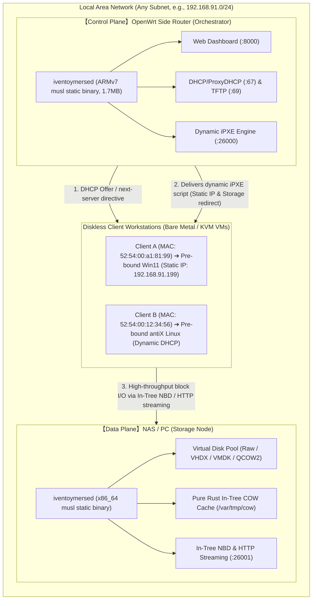

# iventoymersed Decoupled Cluster & Zero-CLI Web Control Complete Tutorial 🇺🇸

> **Cluster Architecture**: Physical decoupling of the **Control Plane** (OpenWrt Side Router Orchestrator) and the **Data Plane** (NAS / Workstation Virtual Disk Storage Node).  
> **Key Strengths**: Zero-Hardcoded IP architecture · 100% Web UI control (0 CLI required) · Client MAC pre-selection & Dual-Channel Static IP injection · Native diskless boot for Windows 11 and Linux with instant start times.

---

## 📖 Table of Contents

1. [Architecture Overview & Decoupling Principles](#1-architecture-overview--decoupling-principles)
2. [Prerequisites & Fleet Topology](#2-prerequisites--fleet-topology)
3. [Step 1: Deploying the Storage Node (Virtual NAS)](#3-step-1-deploying-the-storage-node-virtual-nas)
4. [Step 2: Deploying the Orchestrator on OpenWrt](#4-step-2-deploying-the-orchestrator-on-openwrt)
5. [Step 3: Web UI Setup (0 CLI Configuration)](#5-step-3-web-ui-setup-0-cli-configuration)
6. [Step 4: Client Network Boot & Dynamic Dispatching](#6-step-4-client-network-boot--dynamic-dispatching)
7. [Step 5: Golden Desktop Verification (Live Multi-OS)](#7-step-5-golden-desktop-verification-live-multi-os)
8. [Troubleshooting & FAQs](#8-troubleshooting--faqs)

---

## 1. Architecture Overview & Decoupling Principles

Traditional network boot (PXE) servers combine DHCP/TFTP logic, web administration, and hundreds of gigabytes of disk images onto a single host. In modern edge and enterprise environments, this monolithic design causes three major bottlenecks:
1. **Edge Router Constraints**: Low-cost routers ($15–$25, 128MB–256MB RAM) lack physical disk capacity to store modern multi-gigabyte OS images.
2. **Hardcoded IP Fragility**: Hardcoding IP addresses (such as `192.168.1.1` or `192.168.91.11`) breaks boot scripts whenever the subnet changes or hosts migrate.
3. **Random Client Addressing**: Conventional DHCP hands out random dynamic IP addresses, preventing deterministic static IP assignment for headless or multi-seat workstations before booting.

### 🚀 iventoymersed v3.5.1 Decoupled Cluster Topology



- **Orchestrator**: Runs on an OpenWrt edge side router (RAM footprint < 2MB RSS). Manages the Web UI, stores MAC-to-Image rules in `iventoy.json`, and serves lightweight dynamic iPXE scripts.
- **Storage Node**: Runs on a NAS, Unraid, TrueNAS, or Linux workstation with multi-terabyte NVMe/SATA storage. Serves block devices via pure Rust In-Tree NBD and COW layers.
- **Zero-Hardcoded IP**: The system dynamically detects `window.location.host` and client network context. All generated scripts use dynamic placeholders (`${next-server}` or configured node IP), ensuring seamless zero-touch subnet mobility.

---

## 2. Prerequisites & Fleet Topology

The roles used in our verified test environment:

| Role | Physical / Virtual Node | Operating System | Binary & Specs | Sample IP |
| :--- | :--- | :--- | :--- | :--- |
| **Control Plane (Orchestrator)** | OpenWrt Side Router (ARMv7 / x86) | OpenWrt 23.05 | `iventoymersed` ARMv7 musl (1.7MB) | `192.168.91.11` |
| **Data Plane (Storage Node)** | Storage Workstation / NAS | Linux (Artix / Ubuntu / TrueNAS) | `iventoymersed` x86_64 musl + NVMe pool | `192.168.91.22` |
| **Diskless Client** | Bare-metal PC or KVM Virtual Machine | Diskless (Pure Network Boot) | UEFI IPv4 Network Boot PXE NIC | MAC `52:54:00:a1:81:99` |

---

## 3. Step 1: Deploying the Storage Node (Virtual NAS)

The Storage Node requires only the standalone static binary pointing to your master disk directory.

### 3.1 Prepare Image Directories

Create directories for master images and copy-on-write diff buffers (supported formats: `.raw`, `.img`, `.vhdx`, `.vhd`, `.vmdk`, `.qcow2`, `.iso`):

```bash
mkdir -p /data/vtoy_images
mkdir -p /var/tmp/cow

# Copy your master images into /data/vtoy_images/:
# /data/vtoy_images/win11_golden.vhdx
# /data/vtoy_images/antix23_desktop.vmdk
```

> [!NOTE]
> **Copy-on-Write (COW) Isolation**: All client write requests are redirected on-the-fly to isolated sparse delta files under `/var/tmp/cow/`. Master images remain 100% read-only and immutable. Multiple clients can boot simultaneously from a single master image without cross-contamination.

### 3.2 Launch the Storage Node

Create a simple `config.yaml` or launch with environment variables:

```yaml
# /data/vtoy_images/config.yaml
role: "storage"
storage_node: "0.0.0.0"
storage_port: 26001
image_dir: "/data/vtoy_images"
```

Start the daemon:

```bash
COW_DIR=/var/tmp/cow BRIDGE_CONFIG=/data/vtoy_images/config.yaml ./iventoymersed
```

The terminal will report that the Storage Node is listening on port `26001`.

---

## 4. Step 2: Deploying the Orchestrator on OpenWrt

The side router only needs 1.7MB of storage to hold the single musl static executable.

### 4.1 Upload the Binary to OpenWrt

Transfer the matching architecture binary (e.g., ARMv7 musl) via SCP:

```bash
scp target/armv7-unknown-linux-musleabihf/release/iventoymersed root@192.168.91.11:/opt/bin/iventoymersed
ssh root@192.168.91.11 "chmod +x /opt/bin/iventoymersed"
```

### 4.2 Configure OpenWrt Procd Auto-Start Service

Create `/etc/init.d/iventoymersed` on OpenWrt:

```bash
cat << 'EOF' > /etc/init.d/iventoymersed
#!/bin/sh /etc/rc.common

START=99
STOP=10
USE_PROCD=1

PROG=/opt/bin/iventoymersed
CONF=/etc/iventoymersed/config.yaml

start_service() {
    mkdir -p /etc/iventoymersed
    procd_open_instance
    procd_set_param command "$PROG"
    procd_set_param env BRIDGE_CONFIG="$CONF"
    procd_set_param respawn 3600 5 0
    procd_set_param stdout 1
    procd_set_param stderr 1
    procd_close_instance
}
EOF

chmod +x /etc/init.d/iventoymersed
/etc/init.d/iventoymersed enable
/etc/init.d/iventoymersed restart
```

---

## 5. Step 3: Web UI Setup (0 CLI Configuration)

Open your web browser and navigate to the OpenWrt Orchestrator dashboard:  
👉 **`http://192.168.91.11:8000`** (replace with your router's IP).

### 5.1 Initial Web UI Dashboard

<p align="center">
  
  <br>
  <em>Figure 1: Clean Web UI Dashboard. The system dynamically detects the browser host without hardcoded assumptions.</em>
</p>

### 5.2 Set Cluster Role & Remote Storage Node IP

In the **Cluster Configuration** section at the top:
1. **Cluster Role**: Select **`Orchestrator (Side Router Brain)`**;
2. **Storage Node Host**: Enter the LAN IP of your Storage Node, e.g., **`192.168.91.22`**;
3. **Storage Port**: Enter **`26001`** (default: 26001);
4. Click **`Save Cluster Config`**.

A non-blocking green notification toast (`Cluster configuration saved successfully!`) confirms instant activation and persistence.

### 5.3 Client MAC Pre-Selection & Static IP Binding

In the **MAC Binding & Auto-Boot** section:
1. **Client MAC**: Enter the target client NIC MAC address, e.g., `52:54:00:a1:81:99`;
2. **Target Image**: Enter the master image name on the Storage Node, e.g., `win11_golden.vhdx` (or select from the datalist dropdown);
3. **Client Static IP (Optional)**: Enter the intended static IP, e.g., `192.168.91.199`;
4. Click **`Bind Image`**.

<p align="center">
  
  <br>
  <em>Figure 2: Orchestrator role configured with remote storage 192.168.91.22:26001 and MAC 52:54:00:a1:81:99 bound to static IP 192.168.91.199.</em>
</p>

> [!TIP]
> **Dual-Channel Static IP Injection**:
> 1. When iPXE queries with parameters (`/ipxe?mac=52:54:00:a1:81:99`), the server injects `# Static IP override\nset ip 192.168.91.199` directly at generation time.
> 2. The global menu script also injects `iseq ${net0/mac} 52:54:00:a1:81:99 && set ip 192.168.91.199 ||` for dynamic runtime evaluation, ensuring guaranteed IP application regardless of client firmware behavior.

---

## 6. Step 4: Client Network Boot & Dynamic Dispatching

Power on your diskless client PC or virtual machine and select **UEFI IPv4 Network Boot** in the boot menu.

### 6.1 Phase 1: iPXE Loading and DHCP Handshake

The client NIC sends a PXE broadcast. OpenWrt responds with `ipxe.efi`:

<p align="center">
  
  <br>
  <em>Figure 3: Client acquires lease, initializes iPXE core, and requests configuration from the side router.</em>
</p>

### 6.2 Phase 2: MAC Match & Storage Node Redirection

The client pulls `http://192.168.91.11:26000/ipxe?mac=52:54:00:a1:81:99`. The Orchestrator matches the rule:
- Static IP `192.168.91.199` is applied.
- Boot redirection points directly to the Storage Node at `192.168.91.22:26001`.
- Interactive prompts are bypassed, jumping straight to block device mount:

<p align="center">
  
  <br>
  <em>Figure 4: Client matches pre-bound rule, bypassing manual selection and streaming directly from 192.168.91.22.</em>
</p>

---

## 7. Step 5: Golden Desktop Verification (Live Multi-OS)

Both modern Windows 11 and ultra-lightweight Linux boot natively without physical local storage.

### 7.1 Windows 11 25H2 Verification (Pure Rust In-Tree BCD Hive Auto-Patcher)

The built-in pure Rust BCD Hive patcher rewrites the 16-byte Disk and Partition GUIDs on-the-fly, completely preventing Microsoft's classic `0xc000000e` boot error:

<p align="center">
  
  <br>
  <em>Figure 5: Windows 11 25H2 booted diskless to full desktop (Matterhorn wallpaper, Start menu, taskbar icons, and network connectivity).</em>
</p>

### 7.2 antiX Linux 23 Verification (Multiple Initrd Dynamic Overlay)

Eliminates the requirement for `vtoyboot` modifications on Linux master disks. The dynamic overlay cpio is injected in memory during boot:

<p align="center">
  
  <br>
  <em>Figure 6: antiX Linux 23 running in IceWM (Conky reports 7h 59m uptime, only 239MB RAM used, with stable block I/O throughput).</em>
</p>

---

## 8. Troubleshooting & FAQs

### Q1: `No space left on device` when mounting NTFS via `ntfs3` on Linux Storage Node?
- **Root Cause**: Linux kernel's `ntfs3` driver defaults to preallocating full uncompressed space when creating sparse virtual disks.
- **Fix**: Mount the NTFS partition with `prealloc=0,sparse`:
  ```bash
  mount -t ntfs3 -o prealloc=0,sparse,iocharset=utf8,uid=1000,gid=1000 /dev/sdb1 /mnt/data
  ```

### Q2: Side router shares subnet with main router; client PXE broadcast misses side router?
- **Fix**:
  1. Set **Option 66 (Next Server)** in your main router's DHCP options to the Side Router IP (`192.168.91.11`), and **Option 67 (Bootfile)** to `ipxe.efi`.
  2. Or enable **ProxyDHCP** mode in `iventoymersed` to respond to PXE inquiries without conflicting with existing IP leases.

### Q3: Client connection times out or refused by Storage Node?
- **Checklist**:
  1. Verify TCP port `26001` is open in the firewall on the Storage Node:
     ```bash
     sudo ufw allow 26001/tcp
     ```
  2. Ensure **Storage Node Host** in the Web UI is set to the actual LAN IP of the storage server, not `127.0.0.1`.

### Q4: Virtual machine test shows a black screen (3KB PNG capture)?
- **Fix**: Windows 11 triggered DPMS screen sleep during idle. Send a key event to wake the screen:
  ```bash
  virsh send-key <vm_name> KEY_SPACE
  ```

---

## 🤝 Community & Contributing

- **GitHub Repository**: [https://github.com/obhasashare2024-namo/iventoymersed](https://github.com/obhasashare2024-namo/iventoymersed)
- Pull requests, feedback, and issue reports are warmly welcomed!
