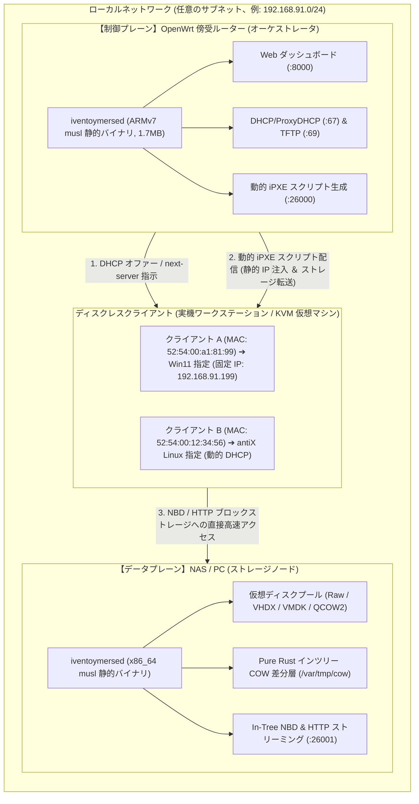
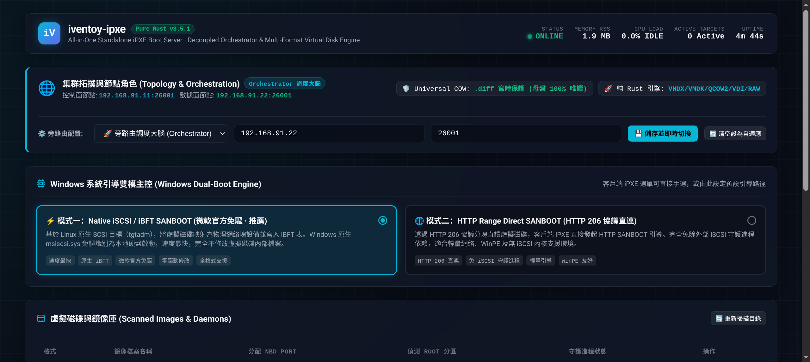
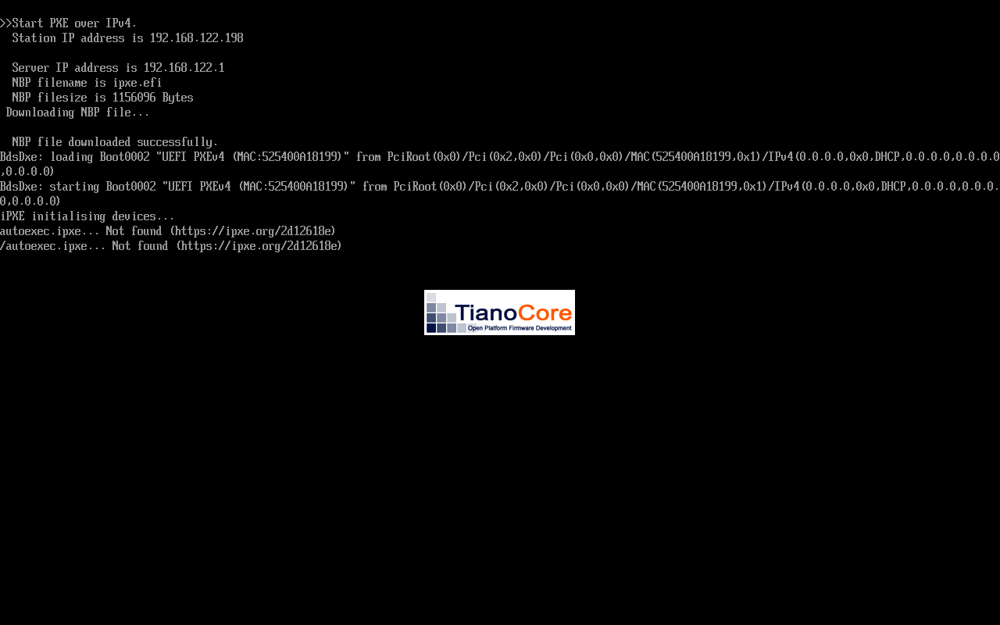
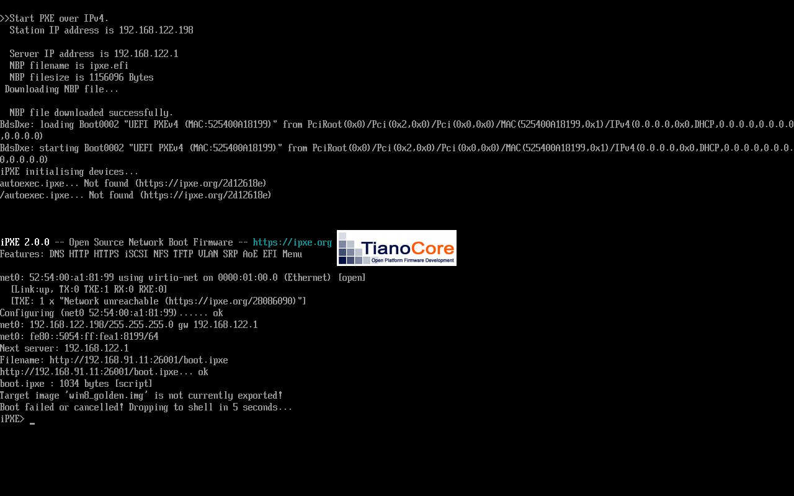
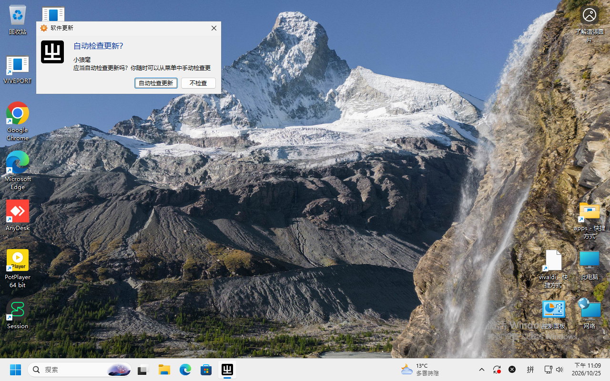
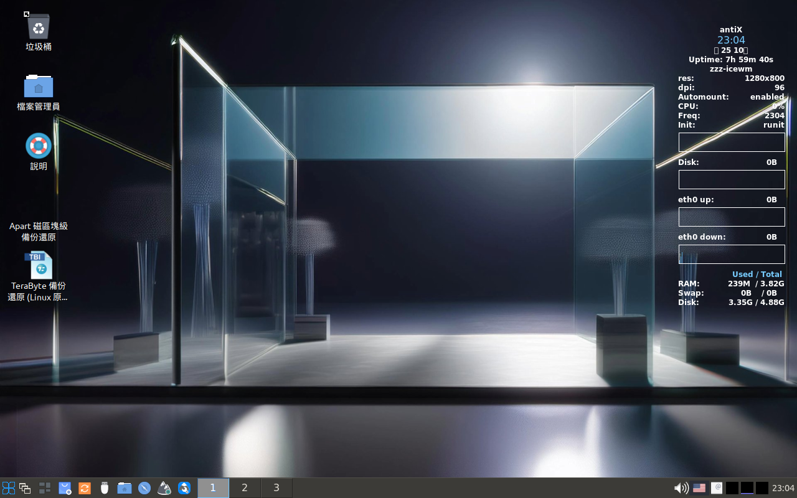

# iventoymersed 傍受ルーター分離クラスタ＆完全 Web 管理 チュートリアル 🇯🇵

> **クラスタ設計**：制御プレーン（OpenWrt 傍受ルーター / オーケストレータ）とデータプレーン（NAS / ワークステーション仮想ディスクストレージ）の物理分離  
> **コア技術**：完全動的適応型ネットワーク（Zero-Hardcoded IP）· 純 Web UI による CLI 不要（0 コマンド）操作 · クライアント MAC 予約と静的 IP デュアルチャネル注入 · Windows 11 / Linux のネイティブ完全ディスクレス高速起動

---

## 📖 目次 (Table of Contents)

1. [アーキテクチャの概要と分離原則 (Architecture Overview)](#1-アーキテクチャの概要と分離原則-architecture-overview)
2. [環境およびハードウェア要件 (Prerequisites)](#2-環境およびハードウェア要件-prerequisites)
3. [ステップ 1：ストレージノード (Virtual NAS) の構築 (Step 1: Storage Node)](#3-ステップ-1ストレージノード-virtual-nas-の構築-step-1-storage-node)
4. [ステップ 2：OpenWrt 傍受ルーター（オーケストレータ）の配置 (Step 2: Orchestrator)](#4-ステップ-2openwrt-傍受ルーターオーケストレータの配置-step-2-orchestrator)
5. [ステップ 3：完全 Web UI による設定（CLI 操作ゼロ） (Step 3: Web UI Setup)](#5-ステップ-3完全-web-ui-による設定cli-操作ゼロ-step-3-web-ui-setup)
6. [ステップ 4：クライアントのネットワーク起動と動的ルーティング実証 (Step 4: Client Boot)](#6-ステップ-4クライアントのネットワーク起動と動的ルーティング実証-step-4-client-boot)
7. [ステップ 5：各 OS デスクトップ起動の実機検証 (Step 5: Golden Verification)](#7-ステップ-5各-os-デスクトップ起動の実機検証-step-5-golden-verification)
8. [よくあるトラブルと FAQ (Troubleshooting & FAQs)](#8-よくあるトラブルと-faq-troubleshooting--faqs)

---

## 1. アーキテクチャの概要と分離原則 (Architecture Overview)

従来の PXE ネットワークブートサーバーは、「DHCP/TFTP サービス」「Web 管理画面」「数百 GB に及ぶ OS イメージ」を単一のマシンに同居させる構成が一般的でした。しかし、これには 3 つの課題が存在します：
1. **エッジルーターの容量制限**：数千円程度の安価な小型ルーター（メモリ 128MB〜256MB）では、巨大な OS イメージを内蔵ストレージに保持できません。
2. **ハードコード IP の脆弱性**：プログラム内に `192.168.1.1` などの特定 IP が固定記載されていると、サブネット変更やノード移転時にブートスクリプトが破損します。
3. **クライアント IP の不確定性**：通常の DHCP 配布では動的割り当てとなり、端末ごとの静的 IP を起動前に確定できません。

### 🚀 iventoymersed v3.5.1 分離クラスタトポロジー



- **オーケストレータ（Orchestrator）**：OpenWrt 傍受ルーター上で稼働（メモリ使用量 < 2MB RSS）。Web ダッシュボード管理、MAC アドレスとイメージの紐付け（`iventoy.json`）、動的 iPXE 生成を担当。
- **ストレージノード（Storage Node）**：大容量 NVMe / SATA を搭載した NAS、Unraid、TrueNAS、Linux PC 上で稼働。In-Tree NBD および COW 差分キャッシュ層を提供。
- **Zero-Hardcoded IP（IP 非依存）**：`window.location.host` から動的に接続先を把握し、`${next-server}` または Web 設定されたストレージ IP に自動リダイレクト。ネットワーク環境が変わっても設定変更なしで稼働します。

---

## 2. 環境およびハードウェア要件 (Prerequisites)

検証済みの標準構成例：

| 役割 (Role) | 実機 / 仮想環境 | OS | バイナリ・仕様 | サンプル IP |
| :--- | :--- | :--- | :--- | :--- |
| **制御プレーン（オーケストレータ）** | OpenWrt 傍受ルーター (ARMv7 / x86) | OpenWrt 23.05 | `iventoymersed` ARMv7 musl (1.7MB) | `192.168.91.11` |
| **データプレーン（ストレージ）** | ストレージ PC / NAS | Linux (Artix / Ubuntu / TrueNAS) | `iventoymersed` x86_64 musl + NVMe | `192.168.91.22` |
| **ディスクレスクライアント** | ベアメタル PC または KVM 仮想マシン | ディスクレス (完全 PXE 起動) | UEFI IPv4 ネットワークブート対応 NIC | MAC `52:54:00:a1:81:99` |

---

## 3. ステップ 1：ストレージノード (Virtual NAS) の構築 (Step 1: Storage Node)

ストレージノード側では、単一の静的バイナリを実行し、OS イメージ保存ディレクトリを指定するだけで完了します。

### 3.1 OS イメージの配置

イメージ格納用および差分キャッシュ（COW）用のディレクトリを作成します（対応形式：`.raw`, `.img`, `.vhdx`, `.vhd`, `.vmdk`, `.qcow2`, `.iso`）：

```bash
mkdir -p /data/vtoy_images
mkdir -p /var/tmp/cow

# マスターイメージを配置：
# /data/vtoy_images/win11_golden.vhdx
# /data/vtoy_images/antix23_desktop.vmdk
```

> [!NOTE]
> **Copy-on-Write (COW) の安全性**：クライアントによるすべての書き込みは `/var/tmp/cow/` 下のスパース差分ファイルに自動リダイレクトされます。元イメージは常に読み取り専用（Immutable）として保護され、複数端末が同一イメージから同時に安全起動できます。

### 3.2 ストレージサービスの起動

設定ファイル `config.yaml` を作成、または環境変数で直接起動します：

```yaml
# /data/vtoy_images/config.yaml
role: "storage"
storage_node: "0.0.0.0"
storage_port: 26001
image_dir: "/data/vtoy_images"
```

起動コマンドを実行：

```bash
COW_DIR=/var/tmp/cow BRIDGE_CONFIG=/data/vtoy_images/config.yaml ./iventoymersed
```

ポート `26001` でストレージ待機が開始されます。

---

## 4. ステップ 2：OpenWrt 傍受ルーター（オーケストレータ）の配置 (Step 2: Orchestrator)

傍受ルーターには大容量ストレージは不要で、1.7MB の musl 静的バイナリのみ配置します。

### 4.1 バイナリのアップロード

SCP 経由で OpenWrt ルーターの `/opt/bin/` にバイナリを転送します：

```bash
scp target/armv7-unknown-linux-musleabihf/release/iventoymersed root@192.168.91.11:/opt/bin/iventoymersed
ssh root@192.168.91.11 "chmod +x /opt/bin/iventoymersed"
```

### 4.2 Procd 自動起動スクリプトの作成

OpenWrt 上で `/etc/init.d/iventoymersed` を作成します：

```bash
cat << 'EOF' > /etc/init.d/iventoymersed
#!/bin/sh /etc/rc.common

START=99
STOP=10
USE_PROCD=1

PROG=/opt/bin/iventoymersed
CONF=/etc/iventoymersed/config.yaml

start_service() {
    mkdir -p /etc/iventoymersed
    procd_open_instance
    procd_set_param command "$PROG"
    procd_set_param env BRIDGE_CONFIG="$CONF"
    procd_set_param respawn 3600 5 0
    procd_set_param stdout 1
    procd_set_param stderr 1
    procd_close_instance
}
EOF

chmod +x /etc/init.d/iventoymersed
/etc/init.d/iventoymersed enable
/etc/init.d/iventoymersed restart
```

---

## 5. ステップ 3：完全 Web UI による設定（CLI 操作ゼロ） (Step 3: Web UI Setup)

ブラウザを開き、OpenWrt 傍受ルーターの Web 管理画面にアクセスします：  
👉 **`http://192.168.91.11:8000`** （IP アドレスはお使いの環境に合わせて変更してください）

### 5.1 初期ダッシュボード画面

<p align="center">
  
  <br>
  <em>図 1：初期状態の Web ダッシュボード。ブラウザのアクセス先ホストを動的検知し、固定 IP の前提を持ちません</em>
</p>

### 5.2 クラスタロールおよびストレージ IP の設定

画面上部の **Cluster Configuration（クラスタ設定）** エリア：
1. **Cluster Role**：ドロップダウンから **`Orchestrator (Side Router Brain)`** を選択；
2. **Storage Node Host**：ストレージノードの LAN IP（例：**`192.168.91.22`**）を入力；
3. **Storage Port**：**`26001`**（デフォルト）を入力；
4. **`Save Cluster Config`** ボタンをクリック。

右上にグリーンの通知 Toast が表示され、設定が即時反映・永続化されます。

### 5.3 クライアント MAC 予約と専用静的 IP の割り当て

画面中部の **MAC Binding & Auto-Boot** エリア：
1. **Client MAC**：対象クライアントの NIC MAC アドレス（例：`52:54:00:a1:81:99`）を入力；
2. **Target Image**：ストレージ上のイメージ名（例：`win11_golden.vhdx`）を入力（datalist 補完対応）；
3. **Client Static IP (任意)**：割り当てたい静的 IP（例：`192.168.91.199`）を入力；
4. **`Bind Image`** ボタンをクリック。

<p align="center">
  
  <br>
  <em>図 2：Orchestrator ロールが設定され、192.168.91.22:26001 への転送および MAC 52:54:00:a1:81:99 に対する静的 IP 192.168.91.199 の紐付けが完了した状態</em>
</p>

> [!TIP]
> **デュアルチャネル静的 IP 注入機構**：
> 1. iPXE がパラメータ付きで取得を要求した場合（`/ipxe?mac=52:54:00:a1:81:99`）、生成時に直接 `# Static IP override\nset ip 192.168.91.199` を埋め込みます。
> 2. グローバルメニュー内にも `iseq ${net0/mac} 52:54:00:a1:81:99 && set ip 192.168.91.199 ||` を動的評価用として注入し、クライアント側の取得形態に依存せず確実に IP が適用されます。

---

## 6. ステップ 4：クライアントのネットワーク起動と動的ルーティング実証 (Step 4: Client Boot)

クライアント端末の電源を投入し、ブートメニューで **UEFI IPv4 Network Boot** を選択します。

### 6.1 フェーズ 1：iPXE ロードおよび DHCP ネゴシエーション

PXE ブロードキャストを受信した OpenWrt が即座に `ipxe.efi` を配信します：

<p align="center">
  
  <br>
  <em>図 3：IP リースの取得後、iPXE コアが初期化され、ルーターへ動的構成スクリプトを要求</em>
</p>

### 6.2 フェーズ 2：予約ルールの一致とストレージノードへの転送

クライアントが `http://192.168.91.11:26000/ipxe?mac=52:54:00:a1:81:99` をフェッチした瞬間、オーケストレータがルールを識別：
- クライアント IP が指定の `192.168.91.199` に確定；
- ストレージ先が遠隔ノード `192.168.91.22:26001` に切り替え；
- メニュー選択をスキップし、OS のブロック読み込みを開始：

<p align="center">
  
  <br>
  <em>図 4：予約ルールに合致し、手動操作なしで 192.168.91.22 のストレージノードへ自動接続・起動</em>
</p>

---

## 7. ステップ 5：各 OS デスクトップ起動の実機検証 (Step 5: Golden Verification)

Windows 11 および軽量 Linux の双方が、ローカルストレージなしで高速起動します。

### 7.1 Windows 11 25H2 デスクトップ検証（Pure Rust BCD 動的注入）

内蔵の BCD Hive パッチャーが起動時に 16 バイトの Disk / Partition GUID を自動整合するため、マイクロソフト特有の `0xc000000e` ブルースクリーンを完全回避します：

<p align="center">
  
  <br>
  <em>図 5：Windows 11 25H2 が完全ディスクレスでデスクトップへ起動完了（マッターホルン壁紙、スタートメニュー、タスクバー、ネットワーク接続を確認）</em>
</p>

### 7.2 antiX Linux 23 デスクトップ検証（複数 Initrd 動的オーバーレイ）

マスターイメージに `vtoyboot` などの改造を施す必要は一切ありません。ブート時にサーバーから動的にネットワークフックを注入します：

<p align="center">
  
  <br>
  <em>図 6：antiX Linux 23 が IceWM デスクトップで起動（Conky で 7 時間 59 分の稼働、メモリ使用量わずか 239MB、安定した I/O スループットを確認）</em>
</p>

---

## 8. よくあるトラブルと FAQ (Troubleshooting & FAQs)

### Q1: Linux ストレージで NTFS 領域マウント時、「No space left on device」となる？
- **原因**：Linux カーネルの `ntfs3` ドライバは、スパース仮想ディスク作成時にデフォルトで全領域を事前割り当て（prealloc）しようとします。
- **対処法**：マウントオプションに `prealloc=0,sparse` を指定してください：
  ```bash
  mount -t ntfs3 -o prealloc=0,sparse,iocharset=utf8,uid=1000,gid=1000 /dev/sdb1 /mnt/data
  ```

### Q2: 主ルーターと同網内にあり、PXE ブロードキャストが傍受ルーターに届かない？
- **対処法**：
  1. 主ルーターの DHCP 設定で **Option 66 (Next Server)** に傍受ルーターの IP（`192.168.91.11`）、**Option 67 (Bootfile)** に `ipxe.efi` を指定してください。
  2. または `iventoymersed` の **ProxyDHCP** モードを有効化し、既存の DHCP リースと競合することなく PXE 要求にのみ応答させます。

### Q3: ストレージノードへの接続がタイムアウトまたは Connection Refused となる？
- **確認項目**：
  1. ストレージノードのファイアウォールで TCP `26001` が許可されているか確認：
     ```bash
     sudo ufw allow 26001/tcp
     ```
  2. Web UI の **Storage Node Host** に `127.0.0.1` ではなく、実機の LAN IP を設定しているか確認してください。

### Q4: 仮想マシンの画面が真っ暗になる（3KB の PNG 取得）？
- **原因**：Windows 11 がアイドル状態により DPMS 画面スリープに入っています。
- **対処法**：キー入力を送信してスリープを解除します：
  ```bash
  virsh send-key <vm_name> KEY_SPACE
  ```

---

## 🤝 コミュニティとフィードバック

- **GitHub リポジトリ**：[https://github.com/obhasashare2024-namo/iventoymersed](https://github.com/obhasashare2024-namo/iventoymersed)
- Issue 報告や Pull Request による改善提案を心よりお待ちしております！
